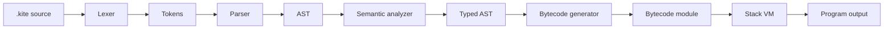

# 🪁 Kite — a small language and compiler built for learning

Kite is a statically typed teaching language designed and implemented by a student compiler team.
Kite source files use `.kite`, the compiler is written in conservative C++20, and programs are
lowered into custom stack bytecode executed by a small virtual machine. The project emphasizes a
complete, inspectable pipeline: source text → tokens → AST → semantic checks → bytecode → VM.

The first milestone is intentionally small: compile and run `print(1 + 2);`. From there, the team
adds variables, control flow, functions, recursion, strings, diagnostics, and tests behind stable
contracts.

---

## Contents

- [Background](#background)
- [Language features](#language-features)
- [Architecture](#architecture)
- [Getting started](#getting-started)
- [Compiler commands](#compiler-commands)
- [Testing and quality](#testing-and-quality)
- [Project structure](#project-structure)
- [Current status](#current-status)
- [Limitations and roadmap](#limitations-and-roadmap)
- [Documentation](#documentation)

---

## Background

Kite is a six-week compiler-course project with a deliberately limited scope. The team is building
the language, compiler, runtime, diagnostics, test corpus, documentation, report, and final demo as
one reproducible repository rather than as disconnected experiments.

The compiler avoids parser generators, LLVM bindings, CLI frameworks, and large dependencies. CMake
and CTest provide the build/test interface, while the upstream doctest v2.5.3 single header supports
unit tests. The MUST tier is designed to remain achievable by one student; arrays, floats, and the
pipe operator are optional SHOULD work and must not delay the core compiler.

## Language features

### MUST

- Mutable `let` variables with lexical block scope and local type inference.
- Explicitly typed function parameters and return values.
- `int`, `bool`, `string`, and `unit` values.
- Arithmetic, comparison, equality, and short-circuit boolean operators.
- `if/else`, `while`, blocks, functions, returns, and recursion.
- Readable compile-time and runtime diagnostics with source line and caret.
- `tokens`, `ast`, `disasm`, `check`, `build`, and `run` CLI commands.
- VM `--trace` mode for demonstrations.

### SHOULD

- C-style `for` loops.
- Floats and arrays.
- The distinctive pipe operator: `5 |> double |> print`.

### Stretch and future work

Structs/records, constant folding, dead-code removal, a REPL, closures, modules/imports, and a
second backend that transpiles Kite to C are documented but do not block the core submission.

## Architecture



Every stage has a documented input/output contract and can be inspected independently with a dump
command or golden test. See [`docs/architecture.md`](docs/architecture.md) for data structures,
opcode stack effects, call-frame layout, diagnostics flow, and extension recipes.

## Getting started

### Requirements

- CMake 3.20 or newer.
- A C++20 compiler: GCC or Clang on Linux/macOS, or MSVC on Windows.
- Ninja is recommended for the supplied presets.

### Configure and build

```sh
cmake --preset linux-debug
cmake --build --preset linux-debug
```

For a sanitizer build on platforms supporting AddressSanitizer and UndefinedBehaviorSanitizer:

```sh
cmake --preset linux-asan
cmake --build --preset linux-asan
```

The core pipeline now compiles and runs the walking skeleton through the lexer, parser, semantic
checker, bytecode generator, and VM. Remaining work covers the larger language feature set and
hardening tasks.

### Run the tests

```sh
ctest --test-dir build/linux-debug --output-on-failure
```

The all-in-one helper is:

```sh
./scripts/test-all
```

On Windows, use `powershell -ExecutionPolicy Bypass -File scripts/test-all.ps1`.

## Compiler commands

After the walking skeleton is complete, the CLI will support:

```sh
./build/linux-debug/kite run examples/hello.kite
./build/linux-debug/kite run examples/pipe.kite --trace
./build/linux-debug/kite check examples/recursion.kite
./build/linux-debug/kite tokens examples/hello.kite
./build/linux-debug/kite ast examples/hello.kite
./build/linux-debug/kite disasm examples/hello.kite
./build/linux-debug/kite build examples/hello.kite -o build/hello.kbc
```

Diagnostics go to stderr. Program output goes to stdout. Exit codes are 0 for success, 1 for
compile errors, 2 for CLI usage errors, 3 for runtime errors, and 4 for internal compiler errors.
Trace output is sent to stderr so it cannot corrupt expected program output.

## Testing and quality

The test pyramid has five layers:

1. Unit tests for diagnostics, lexing, parsing, semantic analysis, bytecode, and VM behavior.
2. Golden tests for token, AST, and disassembly dumps.
3. End-to-end programs using `.src`, `.expected`, `.exitcode`, and optional `.stdin` files.
4. Negative programs asserting diagnostic code, location, and message fragments.
5. Optional lexer/parser crash-resistance fuzz tests after the MUST pipeline is stable.

Every fixed bug requires a regression test. CI builds Debug/Release configurations with warnings as
errors and runs CTest on Linux, macOS, and Windows. Sanitizers are enabled in the Linux ASan/UBSan
preset where the compiler supports them.

## Project structure

```text
src/                  C++20 compiler and runtime modules
  diagnostics/        source spans, diagnostic collection, rendering
  lexer/              tokens and scanner
  parser/             AST nodes, grammar, Pratt precedence
  sema/               symbols, scopes, types, semantic checks
  ir/                 optional future linear IR
  codegen/            bytecode format, disassembler, emitter
  runtime/            values, builtins, VM, runtime errors
  driver/             CLI and pipeline orchestration
tests/                unit, golden, end-to-end, and negative tests
examples/             demo programs and language examples
scripts/              cross-platform build/test/format/example helpers
third_party/doctest/  upstream doctest v2.5.3 single-header test framework
cmake/                build-system notes and reusable CMake support
docs/                 specification, architecture, decisions, plans, and task cards
```

## Current status

The repository contains the planning documents and a compiling scaffold. The public types and
function signatures are present, but lexer, parser, semantic analyzer, code generator, and VM
behavior are intentionally unimplemented. `TODO(Txxx)` comments point to the task card that owns
each implementation.

## Limitations and roadmap

- The walking skeleton is implemented as a CTest end-to-end process test in T014.
- The native-code requirement has been assumed to be absent. If the assignment changes, ADR-0002
  promotes the C-transpile backend to MUST.
- The real assignment rubric has not been supplied; generic compiler-course criteria are mapped in
  [`docs/rubric-traceability.md`](docs/rubric-traceability.md).
- Arrays, floats, and `|>` are SHOULD features and are cut before any MUST feature.
- A REPL, closures, modules, records, optimization passes, and a full debugger are future work.

## Documentation

- [`PLAN.md`](PLAN.md) — master plan, milestone dates, critical path, and self-review.
- [`docs/language-spec.md`](docs/language-spec.md) — draft grammar and semantics.
- [`docs/architecture.md`](docs/architecture.md) — compiler contracts and VM design.
- [`docs/milestones.md`](docs/milestones.md) — schedule, dependencies, and weekly cadence.
- [`docs/task-cards/`](docs/task-cards/) — independently executable 2–8 hour tasks.
- [`CONTRIBUTING.md`](CONTRIBUTING.md) — branches, commits, review, and ownership.

## First task

```sh
git switch -c feat/T001-repo-foundations
```

Then complete [`docs/task-cards/T001-repo-foundations.md`](docs/task-cards/T001-repo-foundations.md)
before starting front-end implementation.
