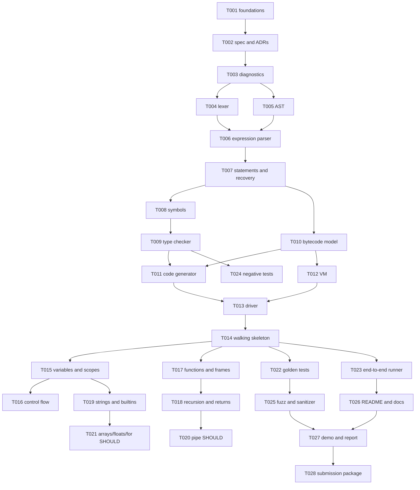

# Milestones and schedule

The planning baseline is Saturday, October 24, 2026 through Saturday, December 5, 2026. M5 has
five days, the buffer is five days (at least 10%), and hardening/release occupies November 29–
December 5, seven days (at least 15%).
No SHOULD item may consume buffer time while a MUST exit criterion is open.

| Milestone | Dates | Scope | Objective exit criteria | Demo artifact | Cut if behind |
|---|---|---|---|---|---|
| M0 Foundations | Oct 24–25 | Docs, ADRs, CMake, diagnostics scaffold | Debug configure/build succeeds; docs and task cards exist; CTest discovers tests | `kite --help` | All stretch planning detail beyond required contracts |
| M1 Walking skeleton | Oct 26–Nov 1 | Lexer, parser, sema, bytecode, VM, CLI path | `print(1 + 2);` exits 0 and prints `3`; tokens/AST/disasm commands work | First end-to-end run | Floats, arrays, pipe |
| M2 Core language | Nov 2–8 | Variables, scopes, expressions, branches, while | Positive and negative tests cover every MUST expression/control construct | `examples/loops.kite` | For loop and arrays |
| M3 Functions | Nov 9–15 | Functions, parameters, returns, calls, recursion, frames | Factorial and Fibonacci examples pass; wrong arity/type tests pass | `examples/recursion.kite` | Any new builtin beyond listed set |
| M4 Type/error hardening | Nov 16–18 | Complete diagnostics, parser recovery, deterministic dumps | Each compile error code has a negative test and caret output | Clean multi-error diagnostic demo | Pretty colors, optional notes |
| M5 Data and pipe | Nov 19–23 | Five days for strings, builtins, SHOULD arrays/floats/for, pipe | Strings and builtins pass; SHOULD features only merge if all MUST tests remain green | `examples/pipe.kite` | Arrays, floats, then pipe in that order |
| Buffer | Nov 24–28 | Five-day slippage and integration repairs | No unresolved MUST blocker; scope freeze at Nov 28 | Re-run full corpus | All remaining SHOULD work |
| M6 Hardening | Nov 29–Dec 2 | Sanitizers, fuzz smoke, performance, docs | Debug/Release/sanitizer checks recorded; 1,000-line smoke target measured | Clean build report | Fuzzing if it threatens release |
| M7 Release | Dec 3–5 | Report, demo, packaging, clean-machine rehearsal | Submission archive unpacks and builds; demo follows script; report references evidence | Final presentation run | Cosmetic README changes only |

## Dependency graph

## Staffing plans

### One student

Follow the critical path in order. Spend the first four weeks only on MUST work. Start documentation
and tests in parallel as interfaces stabilize. Cut arrays, floats, pipe, fuzzing, and cosmetic CLI
features first. The MUST implementation budget is capped at roughly 40–44 hours.

### Two students

Student A owns lexer/parser/sema. Student B owns bytecode/VM/driver. Both review diagnostics and
tests. T019 and T022–T026 can proceed in parallel once T014 defines the pipeline contract.

### Three students

Student A owns lexer/parser and AST. Student B owns symbols/types/diagnostics. Student C owns
bytecode/VM/driver. All three agree on `Token`, AST, `Diagnostic`, and `BytecodeModule` contracts in
M0. A shared integration branch is updated at each milestone; no one works directly on another
owner's internal files without a review.

## Weekly cadence

1. Monday: 20-minute planning; select cards whose dependencies are green.
2. Midweek: each owner posts one failing or passing test and one risk update.
3. Friday: runnable demo, even if the demo is a dump command or diagnostic case.
4. Saturday: definition-of-done review; merge only code with tests and updated docs.
5. If behind: freeze new features, repair MUST path, cut arrays, floats, pipe, fuzzing, then cosmetic output.
